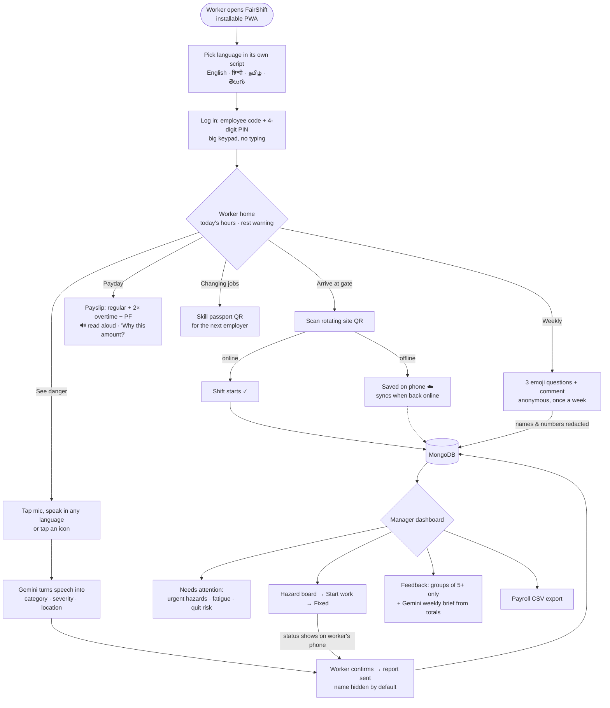
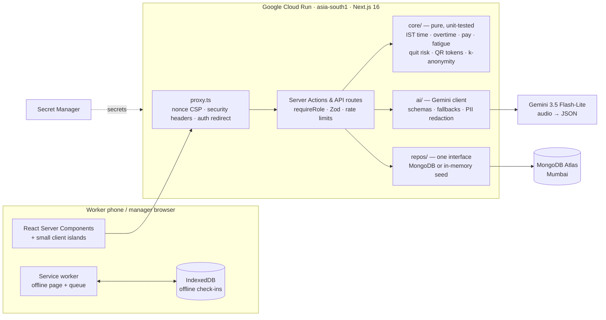

# FairShift — Decent Work Platform

**Prompt Wars 2026 × SRM ACM · UN SDG 8 (Decent Work & Economic Growth)**

A voice-first, multilingual PWA for daily-wage and shift workers, plus an early-warning dashboard for employers.

- **Workers** get proof of their hours and a payslip they can understand (and hear).
- **Workers** get a safe way to report hazards and to speak up anonymously, plus a portable skill record.
- **Employers** see fatigue, safety and attrition risk early enough to act.

One codebase serves **construction sites and hospitals** (campus and factory profiles included) through sector configuration.

> **The AI understands; the code computes.** Gemini turns speech in Tamil, Hindi, Telugu or English into structured reports, and rewords explanations. Every rupee, hour, fatigue flag and risk score comes from pure, unit-tested TypeScript, never from the model.

## Try it

```bash
npm install
cp .env.example .env.local        # optional: add GEMINI_API_KEY for live AI
npm run dev                        # http://localhost:3000
```

Pick a language, then tap a demo login:

| Persona | Who | Shows |
|---|---|---|
| **Ramesh** (code `1001`, PIN `1234`) | Mason, BuildRight Constructions, Chennai · Tamil | QR check-in, overtime on payslip, voice hazard report |
| **Sunita** (code `2001`, PIN `1234`) | Ward attendant, City Care Hospital, Lucknow · Hindi | Night-shift fatigue warning, anonymous feedback, skill passport |
| **Priya** (`priya@buildright.demo` / `demo1234`) | Site manager | Live KPIs, hazard queue, people risk, payroll CSV, QR kiosk |
| **Dr. Arjun** (`arjun@citycare.demo` / `demo1234`) | Hospital admin | Same dashboard, hospital rules |

The app runs **with no API key and no cloud account**. Seeded in-memory data and deterministic AI fallbacks make the demo impossible to break.

**Pitch deck:** open `/pitch` on the running app (arrow keys to move between slides).

## Who uses it

| User | Where they are | What they need from FairShift |
|---|---|---|
| **Shift worker** (mason, ward attendant, cleaner, line operator) | Budget Android phone, patchy data, may not read well, speaks Tamil / Hindi / Telugu | Proof of hours, a payslip they understand, a safe way to report danger and speak up, a record of their skills |
| **Supervisor / site manager** | Laptop or phone at the site office | See who is on site, who is overworked, which hazards are open, who might quit, and export payroll |
| **Gate kiosk** | A spare phone or tablet at the site gate or ward desk | Show a rotating QR code that workers scan to check in |
| **Next employer** | Anywhere, via a shared link | Verify a worker's skills without seeing anything else about them |

## User flow



## Architecture



**Why this shape:** the model never produces a number. Gemini only *understands* (speech → structured report, numbers → plain words); every amount, hour and score comes from `src/core`, so it is testable and the same every time.

## What makes FairShift different

1. **Voice-first in four Indian languages.** Workers speak a hazard in Tamil, Hindi or Telugu; the app turns it into a structured report and reads every screen aloud.
2. **"The AI understands, the code computes."** Payslips and risk scores never come from the model, and AI rewording is rejected if a single number changes.
3. **Anonymity enforced by design.** Feedback is stored with no worker id (a one-way HMAC only blocks double votes), timestamps are kept to the day, names and phone numbers are redacted, and managers only see groups of 5 or more.
4. **Works offline on a cheap phone.** Check-ins queue on the device and sync later without duplicates; the rotating QR still validates offline scans for 12 hours.
5. **Explainable early warnings.** Every quit-risk score shows its reasons, so managers get a prompt to talk, not a black-box label.
6. **One app, many sectors.** Construction and hospital rules (pay basis, night shifts, hazard types) are configuration, not separate products.

## How it maps to the brief

| Judging criterion | What FairShift does | Evidence |
|---|---|---|
| **Real-world impact** | Unpaid overtime becomes visible. Hazards reach the manager in seconds, and the worker sees each status change. Fatigue and quit risk are flagged with reasons. | `/w/pay`, `/w/report` → `/a/hazards` → worker timeline (e2e-tested) |
| **SDG 8 relevance** | **8.5** decent work and fair pay (transparent payslips, 2× overtime). **8.8** labour rights and safe working environments (hazard reporting, anonymous voice, fatigue rules). | Payslip engine, hazard + feedback flows |
| **Inclusivity & ease of use** | 4 languages in native scripts. 🔊 read-aloud on every screen. Voice input in any language. Icon-first tiles, 48 px+ targets, menus never more than 2 levels deep. Works offline (queued check-ins). Light canvas animation that switches off for reduced-motion and Data Saver users. | axe: 0 violations on every tested page |
| **Technical implementation** | Next.js 16 App Router, strict TypeScript, nonce CSP, signed sessions, role checks on every action, Zod everywhere, rate limits, CI | 117 unit + 21 e2e tests, core coverage 99% |
| **Feasibility & scalability** | Sector profiles (pay basis, shift rules, hazard types, fatigue rules) and a multi-org data model. Stateless Cloud Run container. | `src/core/sectors/*`, `Dockerfile` |

**Deliverables:**
- 3+ working features ✅ (W1–W7, A1–A7)
- 2 UIs ✅ (worker `/w`, admin `/a`)
- 2+ industries ✅ (construction, hospital)

## Features

**Worker app (`/w`, mobile PWA)**

- **QR check-in/out.** A rotating site QR (HMAC, 30 s window) is shown on a kiosk. Works offline: scans queue in IndexedDB, sync idempotently, and keep the scan time. Demo: "scan site QR".
- **Clear payslip.** Regular, overtime and PF in ₹ (Indian digit grouping), per IST month. Overtime is counted daily or weekly, whichever pays the worker more.
  - "Why this amount?" gives an always-correct template explanation in the worker's language, read aloud.
  - "Explain in simple words" asks Gemini to reword it. The rewording is accepted only if every number survives unchanged.
- **Report danger.** Tap the mic and speak in any language, or tap an icon.
  - Gemini 3.5 Flash-Lite turns the audio into category, severity and location as schema-checked JSON.
  - The worker confirms before anything is saved. Severity floors are applied in code (falls, electrical and needle-stick are never below *high*).
  - Optional photo, compressed on the phone. Anonymous by default; the device keeps a private tracking cookie.
- **Speak up.** 3 emoji questions plus a comment, once per week.
  - Stored with **no worker id**: a one-way HMAC guard prevents double votes, and timestamps are kept to the day only.
  - Names and phone numbers are redacted. Employers see groups of 5 or more only.
- **Rest nudges.** Sector fatigue rules (more than 10 h a day, less than 11 h rest, 7 days without a day off, 3+ nights in a row, more than 48 h a week).
- **Skill passport.** Verified skills, plus a QR code with a signed public link for the next employer.

**Admin dashboard (`/a`)**

- **Overview.** On site now, overtime this week, open hazards, mood, workers at risk.
  - "Needs attention" list.
  - Attendance and overtime charts, with a table fallback for screen readers.
  - AI transparency log: model, latency and fallback used (never content).
- **Hazards.** Board grouped by status, highest severity first. Guarded transitions; every change is pushed to the worker's timeline.
- **People.** Hours, overtime, broken fatigue rules, and an **explainable quit-risk score**: each factor shows its points.
- **Feedback.** Per site and week, k-anonymity gate, multilingual themes, and a **Gemini weekly brief built from totals only**.
- **Payroll.** Monthly table and CSV export, with spreadsheet formula-injection escaping.
- **Sites & QR kiosk.** Sector rules per site and a full-screen rotating QR.

## Architecture

```
Worker phone (PWA)            Admin browser
 RSC pages + small islands      RSC pages + Recharts
 offline queue (IndexedDB)
 service worker (Serwist)
        │  same-origin HTTPS only
        ▼
 Cloud Run · Next.js 16 standalone (Node 24)
  src/proxy.ts      nonce CSP, security headers, optimistic auth redirect
  src/server/       sessions, requireRole(), rate limits, services, repos
  src/core/         PURE: time (IST), overtime, pay, fatigue, risk, QR, anonymity, sectors
  src/ai/           Gemini client, schemas, prompts, fallbacks, redaction, log
        │
        ▼
 Gemini API: 3.5 Flash-Lite (audio → JSON), 3.8 Flash (fallback, weekly brief)
```

- **Data** sits behind a `Repos` interface: **MongoDB** in production (`MONGODB_URI`; an empty database is auto-seeded and indexed on first connect), deterministic in-memory seed for local dev and tests (2 orgs, 3 sites, 12 workers, 3 weeks of shifts).
- **AI fallback chain:** fast model → fallback model → keyword classifier (en/hi/ta/te) → keyless demo fixtures → *"not understood, tap an icon"*. The app never invents what a worker said.
- **Prompt-injection boundary:**
  - User text is fenced as `<untrusted>`.
  - Output is Zod-validated against enums, and categories are limited to the worker's sector.
  - Code decides the final severity.

## Security

- Nonce-based CSP with no `unsafe-inline` for scripts, plus `frame-ancestors 'none'`, HSTS, `nosniff`, Referrer-Policy, Permissions-Policy (camera, mic, location limited to this site), and COOP.
- HMAC-signed httpOnly session cookie. `requireRole()` runs in every page, Server Action and Route Handler; the proxy redirect is only an optimistic first check.
- PINs and passwords use scrypt with constant-time compares. Login is rate-limited per account and per IP.
- Zod validates every input. Body caps: audio 1 MB, sync batch 16 KB. Same-origin checks on POST routes. Secrets live only on the server; nothing is exposed through `NEXT_PUBLIC_*`.
- Personal pages and APIs are never cached by the service worker.
- `npm audit`: 0 vulnerabilities.

## Quality

| Check | Result |
|---|---|
| `npm run lint` (`--max-warnings=0`) | clean |
| `npm run typecheck` (strict) | clean |
| `npm run coverage` | **117 tests**, `src/core` **99% lines / 96% branches** |
| `npm run e2e` (Playwright, Pixel 7 + desktop) | **24 tests**, axe **0 WCAG 2.1 AA violations** on every tested page |

## Deploy to Cloud Run

```bash
gcloud run deploy fairshift --source . --region asia-south1 --allow-unauthenticated \
  --set-env-vars DEMO_MODE=true \
  --set-secrets SESSION_SECRET=fairshift-session:latest,FEEDBACK_HMAC_SECRET=fairshift-feedback:latest,GEMINI_API_KEY=gemini-key:latest,MONGODB_URI=mongodb-uri:latest
```

The multi-stage `Dockerfile` runs as a non-root user on port 8080 with a health check. CI (`.github/workflows/ci.yml`) runs lint, typecheck, coverage, audit and e2e, then builds the image and smoke-tests it.

## Google services

| Service | Job |
|---|---|
| **Gemini 3.5 Flash-Lite** | Multilingual speech → structured hazard (audio input + JSON schema); plain-language payslip rewording |
| **Gemini 3.8 Flash** | Fallback model; weekly workforce brief from aggregates |
| **Cloud Run** | Stateless container hosting (asia-south1), autoscaling |
| **Secret Manager** | Session, feedback and Gemini secrets |
| **Google Fonts (Noto)** | Devanagari, Tamil and Telugu scripts, self-hosted at build via `next/font` |

## Roadmap

- IVR / missed-call reporting for feature phones.
- Payslip links over WhatsApp/SMS.
- State-specific labour rules (the defaults are 8 h/day, 48 h/week and 2× overtime; notification dates vary by state).
- Server-side text-to-speech for devices without Indic voices.

## Credits

- The landing background is adapted from the "Waves" canvas demo in the team's animation library (`D:/Animations`), optimised for low-end phones.
- Built with AI coding assistants (including Google Antigravity agent runs) and Gemini, as the rules allow.
