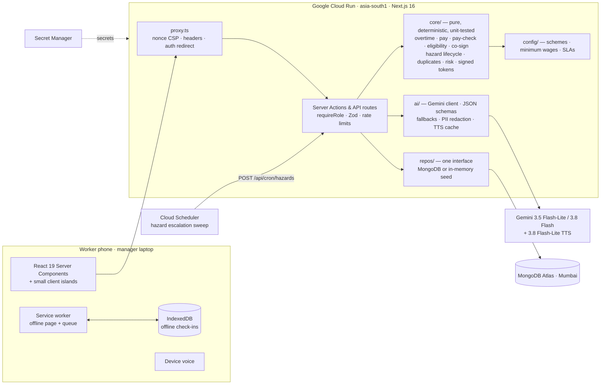

# FairShift — Decent Work, Counted Fairly

> **Prompt Wars 2026 × SRM ACM · UN SDG 8 (Decent Work & Economic Growth)**
> A voice-first, four-language workplace app for daily-wage and shift workers — and an early-warning dashboard for the employers who want to treat them fairly. One codebase, **construction sites and hospitals**.

[](https://github.com/amanmaskara04/fairshift/actions/workflows/ci.yml)


**Live demo:** Cloud Run (`asia-south1`) — see [Deploy](#deploy-to-google-cloud-run) · Preview mirror: <https://fairshift-ashy.vercel.app>
**One tap in, no sign-up:** open the app and tap a demo person below.

| Demo login | Who | Shows |
|---|---|---|
| **Ramesh** · code `1001`, PIN `1234` | Mason, BuildRight Constructions, Chennai · Tamil | QR check-in, *earned so far*, **₹907 possible overtime shortfall**, BOCW progress **72/90 days**, voice hazard report |
| **Sunita** · code `2001`, PIN `1234` | Ward attendant, City Care Hospital, Lucknow · Hindi | Night-shift fatigue warning, animated feedback faces, **“Me too” on a 4-of-5 issue → escalates live**, ESIC & e-Shram eligibility |
| **Priya** · `priya@buildright.demo` / `demo1234` | Construction employer | Escalated hazards, pay sentinel, co-signed issues, certificate approvals, payroll CSV, QR kiosk |
| **Dr. Arjun** · `arjun@citycare.demo` / `demo1234` | Hospital employer | The same dashboard with hospital rules, wards and escalation chain |

The app runs **with no API key and no cloud account**: seeded data (generated relative to *today*) and deterministic fallbacks for every AI feature. A 3-minute judge walkthrough is in [`docs/demo-script.md`](docs/demo-script.md).

---

## At a glance

- **Problem.** India's 40+ crore unorganised workers can't prove their hours, can't read their payslips, fear speaking up, lose their work history when they change jobs, and miss the welfare they're entitled to because claiming it needs paperwork they don't have.
- **Solution.** A phone app in their own language that **records every hour, checks every rupee against what was actually paid, lets workers raise issues safely in numbers, turns verified attendance into welfare eligibility and a signed work certificate**, and gives employers an honest early-warning dashboard.
- **Why it's trustworthy.** *The AI phrases, the code computes.* Every rupee, hour, deadline, eligibility and risk score comes from pure, unit-tested TypeScript in [`src/core`](src/core). Gemini only understands speech, matches similar complaints, rewords explanations and reads aloud — and every one of those has a deterministic fallback.
- **Google technology.** Gemini 3.5 Flash-Lite / 3.8 Flash (structured JSON output), Gemini 3.8 Flash-Lite TTS (Tamil/Telugu read-aloud), Cloud Run, Secret Manager, Cloud Build, Cloud Scheduler, Google Fonts (self-hosted).
- **Evidence.** 250 unit tests + 31 Playwright end-to-end tests with axe accessibility scans on every screen; 95%+ coverage gate on the core; CI on every push.

## Pain point → feature → code

| Pain point (from the problem statement) | FairShift feature | Where |
|---|---|---|
| Unrecorded hours and unpaid overtime | QR check-in (rotating HMAC token, offline queue), payslip with 2× overtime, *“Why this amount?”* | [`core/overtime.ts`](src/core/overtime.ts) · [`core/pay.ts`](src/core/pay.ts) · [`w/checkin`](src/app/w/checkin) |
| “The payslip says one thing, I was paid another” | **FairPay Sentinel**: compares attendance with what the employer recorded as paid; *Possible shortfall ₹907* with the arithmetic; one-tap review request → dispute workflow; admin records pay from presets/sliders and **“Pay the gap”** settles it (the shortfall disappears for the worker) | [`core/pay-check.ts`](src/core/pay-check.ts) · [`services/disputes.ts`](src/server/services/disputes.ts) · [`w/pay`](src/app/w/pay/page.tsx) |
| Wages below the legal minimum | Minimum-wage check per state/sector/skill (demo table, clearly labelled) | [`config/minimum-wage.ts`](src/config/minimum-wage.ts) |
| Missed welfare benefits, no proof of days worked | **Benefits Unlocker**: BOCW board, e-Shram, ESIC, PM-SYM eligibility from verified days; progress ring; how-to-apply sheet; **HMAC-signed 90-day work certificate** | [`config/schemes.ts`](src/config/schemes.ts) · [`core/eligibility.ts`](src/core/eligibility.ts) · [`certificate/[token]`](src/app/certificate) |
| Fear of retaliation for speaking up | Anonymous weekly feedback (groups of 5+), and **“Safe in numbers”** co-signed issues: invisible to management until 5 workers sign; signers never stored | [`core/cosign.ts`](src/core/cosign.ts) · [`services/issues.ts`](src/server/services/issues.ts) |
| Unsafe sites, hazards ignored for days | Voice/photo hazard reports in 4 languages; **age timers**, severity deadlines, **auto-escalation** supervisor → site manager → safety officer; dismiss needs a reason; *“Is it really fixed?”* closes the loop; duplicates merged (only the same danger at the same site); **fire is critical in every sector**, and urgent words (fire, trapped, unconscious…) raise severity in 4 languages | [`core/hazard-lifecycle.ts`](src/core/hazard-lifecycle.ts) · [`core/hazard-duplicates.ts`](src/core/hazard-duplicates.ts) · [`core/hazard-urgency.ts`](src/core/hazard-urgency.ts) · [`config/hazard-sla.ts`](src/config/hazard-sla.ts) |
| Fatigue, long shifts, night work | Sector fatigue rules (10h day, 11h rest, 3 nights in a row, 48h week) on the worker home and the manager board | [`core/fatigue.ts`](src/core/fatigue.ts) · [`core/sectors`](src/core/sectors) |
| Lost career history when changing jobs | **Skill passport**: verified work history from attendance + skills (worker adds a skill → employer verifies it), worker chooses what to share, **signed link that expires in 30 days** | [`core/work-history.ts`](src/core/work-history.ts) · [`core/signed-token.ts`](src/core/signed-token.ts) |
| Employers learn about attrition too late | Explainable individual quit-risk (overtime trend, missed days, pay disputes) with **site conditions shown separately** | [`core/risk.ts`](src/core/risk.ts) · [`a/people`](src/app/a/people/page.tsx) |
| Nowhere to turn in a crisis | **Help tab**: one-tap 112, verified national helplines (fire, ambulance, women 181, Tele-MANAS, e-Shram, ESIC, EPFO), and *“Tell us the problem”*: AI next steps, the right helpline and where in FairShift to act | [`config/helplines.ts`](src/config/helplines.ts) · [`core/help-triage.ts`](src/core/help-triage.ts) · [`ai/help.ts`](src/ai/help.ts) · [`w/help`](src/app/w/help/page.tsx) |
| Low literacy, many languages, cheap phones | 4 languages incl. native scripts, read-aloud everywhere (device voice → Gemini TTS fallback), voice input, big targets, offline, light SVG-only visuals | [`messages/`](src/messages) · [`lib/speak.ts`](src/lib/speak.ts) · [`api/tts`](src/app/api/tts/route.ts) |

## Two sectors, one product

| | Construction (BuildRight, Chennai) | Hospital (City Care, Lucknow) |
|---|---|---|
| Pay basis | Daily wage | Monthly salary |
| Roster | Mon–Sat, Sunday rest | Rotating rest day, night shifts |
| Fatigue rules | 10h day, 11h rest, 6 days, 48h week | 3+ nights in a row, 11h rest, 12h day, 48h week |
| Hazard types | Fall, scaffolding, electrical, heat, PPE, machinery | Needle-stick, biohazard, patient aggression, slip, lifting, PPE |
| Escalation chain | Supervisor → site manager → safety officer | Ward in-charge → nursing superintendent → safety officer / HR |
| Welfare schemes | BOCW board (90 days of building work), e-Shram, PM-SYM | ESIC, e-Shram, PM-SYM |

Everything that differs is **configuration** ([`core/sectors`](src/core/sectors), [`config/`](src/config)); campus and factory profiles are included.

## Architecture



### The AI phrases, the code computes

| AI feature | What Gemini does | If Gemini is unavailable | Guard rail |
|---|---|---|---|
| Voice hazard report | Speech/text → category, severity judged from what is happening, location (JSON schema) | Phone speech recognition + keyword classifier in 4 scripts | Category must be in the sector's list; code can only raise severity: floors in `core/hazard-rules.ts`, urgent words in `core/hazard-urgency.ts` |
| *“Tell us the problem”* (Help) | Urgency, topic, up to 4 next steps in the worker's language, helpline ids, in-app action | Keyword triage + translated template steps | Text PII-scrubbed and never stored; helplines only from the fixed list; digits stripped from model text; an emergency in the words always shows 112 first |
| *“Explain in simple words”* | Rewords the exact payslip sentences | Template sentences (always shown first) | Rejected if a single number changes |
| Weekly brief | 3–5 actions from **totals only** | Deterministic template | No names, comments or per-worker rows are sent |
| “Is it one of these?” | Matches a new issue to existing ones across languages | Keyword-overlap similarity | Only already-scrubbed issue texts are sent |
| Read aloud (Tamil/Telugu on desktop) | Gemini TTS, cached per sentence | “Audio not available on this device” | Public route speaks only language names; everything else needs a session |

Every call is logged (feature, model, latency, fallback, content-free error) **in the database**, so the admin's *AI transparency* panel survives serverless restarts. `GET /api/health` reports `ai: configured | missing_key`.

## Privacy and security by design

- **Groups of 5.** Feedback is shown only for cohorts of 5+ responses; co-signed issues are invisible to management until 5 workers sign — *not even a count* leaks below the threshold ([`core/anonymity.ts`](src/core/anonymity.ts), [`core/cosign.ts`](src/core/cosign.ts)).
- **Signers are never stored.** Double-voting and double-signing are blocked with `HMAC(secret, worker + week/issue)` — a one-way key, useless without the server secret. Issue creators count as the first signer with no identity stored; timestamps are coarsened to the day.
- **PII scrubbing** of names (every worker and admin in the org), phone numbers, emails and long ids before anything is stored ([`ai/redact.ts`](src/ai/redact.ts)).
- **Anonymous hazard reports** get a private tracking reference (`FS-7KQ2MZ`); only its HMAC is stored, so the reporter can confirm a fix without being identifiable.
- **AI only sees totals** for management summaries, and user text is wrapped as untrusted data in every prompt.
- **Signed, expiring links.** Skill passports and work certificates use HMAC-SHA256 tokens with the token *kind* bound into the MAC; passports expire after 30 days; tampered links get a friendly “could not be verified” page.
- **Every mutation** is a Server Action or API route with `requireRole` (worker vs admin, org-scoped), **Zod** validation and **rate limits** on login, hazard reports, issues, disputes, CSV imports, TTS and AI calls.
- **Headers.** Per-request nonce CSP with `strict-dynamic`, HSTS, `nosniff`, `frame-ancestors 'self'`, no `x-powered-by`; same-origin and body-size checks on JSON routes; CSV export neutralises formula injection.
- **Secrets** come from env / Secret Manager only; the app refuses to start in production without them. Nothing secret is committed (`.env*` ignored; [`.env.example`](.env.example) documents every variable).

## Accessibility and inclusivity

- **Four languages** (English, हिन्दी, தமிழ், తెలుగు), every string translated — enforced by a test that all locale files have the same keys and placeholders. `<html lang>` follows the language; the language menu changes it **in place without a history entry**.
- **Anek**, one multi-script font family, so Latin, Devanagari, Tamil and Telugu look like one brand; Indic text is never split letter-by-letter in animations (that breaks conjuncts).
- **Read-aloud on every screen** with a server TTS fallback, **voice input** for hazards, comments and issues, big targets (≥48px), haptic taps.
- **WCAG AA light theme** with contrast verified by [`tests/unit/design/contrast.test.ts`](tests/unit/design/contrast.test.ts); visible focus rings; ARIA radiogroups for the faces, menus with full keyboard support, `aria-live` for check-in, report sent and reviews; **axe scans on every page in CI**.
- **Motion with care:** only `transform`/`opacity` animate; `prefers-reduced-motion` turns movement into short fades; loops pause when the tab is hidden.
- **Back that behaves like an app:** tabs, steps, sheets and form submissions never add history entries; an in-app stack (sessionStorage) makes the Back button and the browser Back agree.

## Performance on a ₹7,000 phone

Server Components by default; client JS only for interactive islands. The animated scene is **inline SVG + CSS keyframes** (a few KB, no Lottie, no video, no animation library — page transitions use React 19's native `<ViewTransition>`). Admin charts are plain server-rendered HTML bars (no chart library, no client JS). Fonts are self-hosted with only Latin preloaded. Icons are tree-shaken. The service worker precaches the shell; check-ins work offline.

## Testing

```bash
npm test             # 250 unit tests (Vitest): core engine, services, AI fallbacks, i18n parity, contrast
npm run coverage     # with the ≥95% coverage gate on src/core
npm run e2e          # 31 Playwright tests on a production build, with axe on every screen
npm run lint && npm run typecheck
```

Highlights: overtime underpaid / regular underpaid / below minimum wage / exact match / ₹1 rounding tolerance / missing record · eligibility at 89, 90, 91 days and the 12-month window boundary · double-sign blocked, the 4→5 threshold, admin sees nothing below it, PII removed · hazard deadline boundaries, reopen restarts the timer, dismiss without a reason rejected, 48-hour duplicate boundary, severity bump at 3 reports · expired and tampered tokens rejected, share toggles hide the right sections, work-history totals equal attendance · *earned so far* equals the payslip · the Back-button acceptance path (Home → Pay ×2 months → Report → Me and back).

## Evaluation criteria → evidence

| Criterion | What we did | Where to look |
|---|---|---|
| **Code quality** | Pure `core/` with no I/O; one repository interface; config over code; typed end to end; ESLint (React Compiler rules) with zero warnings | [`src/core`](src/core), [`src/config`](src/config), [`src/server/repos/types.ts`](src/server/repos/types.ts) |
| **Security** | Nonce CSP, role + org checks on every mutation, Zod everywhere, rate limits, HMAC guards and signed tokens, Secret Manager | [`proxy.ts`](src/proxy.ts), [`server/actions`](src/server/actions), [`core/signed-token.ts`](src/core/signed-token.ts) |
| **Efficiency** | Batched queries, concurrent payslips, idempotent hazard sweep, cached TTS, lazy charts, SVG-only visuals | [`services/workforce.ts`](src/server/services/workforce.ts), [`ai/tts.ts`](src/ai/tts.ts) |
| **Testing** | 272 unit + 35 e2e, coverage gate, CI on every push | [`tests/`](tests), [`.github/workflows/ci.yml`](.github/workflows/ci.yml) |
| **Accessibility** | AA contrast test, axe in CI, keyboard menus/radiogroups, live regions, reduced motion, 4 languages + voice | [`tests/e2e`](tests/e2e), [`globals.css`](src/app/globals.css) |
| **Problem alignment** | Worker + employer interfaces, construction + hospital, every brief pain point mapped above | [Pain point table](#pain-point--feature--code) |

## Getting started

```bash
npm install
cp .env.example .env.local     # optional: add GEMINI_API_KEY for live AI
npm run dev                    # http://localhost:3000
```

| Script | Does |
|---|---|
| `npm run dev` / `build` / `start` | Next.js development / production build / server |
| `npm test` / `coverage` / `e2e` | Unit tests / with coverage gate / Playwright + axe |
| `npm run lint` / `typecheck` | ESLint (zero warnings) / TypeScript |
| `npm run icons` | Regenerates favicon and PWA icons from the logo geometry |

Without `MONGODB_URI` the app uses an in-memory store seeded relative to today. With it, MongoDB is seeded on first connection and — in demo mode — re-seeded once per IST day, so the demo never shows a stale week.

## Deploy to Google Cloud Run

The image is a multi-stage, non-root [`Dockerfile`](Dockerfile) using Next.js `output: "standalone"`; [`.dockerignore`](.dockerignore) and [`.gcloudignore`](.gcloudignore) keep secrets and build output out.

**One command** (creates secrets in Secret Manager, grants access, builds with Cloud Build, deploys to `asia-south1`, and schedules the hazard escalation sweep every 15 minutes):

```bash
MONGODB_URI='mongodb+srv://…' bash scripts/deploy-cloudrun.sh <gcp-project-id> <gemini-api-key>
```

Or by hand:

```bash
gcloud services enable run.googleapis.com cloudbuild.googleapis.com secretmanager.googleapis.com cloudscheduler.googleapis.com
printf '%s' "$GEMINI_API_KEY" | gcloud secrets create fairshift-gemini-key --data-file=-
# …likewise fairshift-mongodb-uri, -session-secret, -feedback-secret, -passport-secret, -cron-secret
gcloud run deploy fairshift --source . --region asia-south1 --allow-unauthenticated \
  --min-instances 1 --memory 1Gi --set-env-vars DEMO_MODE=true \
  --set-secrets GEMINI_API_KEY=fairshift-gemini-key:latest,MONGODB_URI=fairshift-mongodb-uri:latest,SESSION_SECRET=fairshift-session-secret:latest,FEEDBACK_HMAC_SECRET=fairshift-feedback-secret:latest,PASSPORT_SECRET=fairshift-passport-secret:latest,CRON_SECRET=fairshift-cron-secret:latest
curl https://<service-url>/api/health   # {"status":"ok","db":"mongodb","ai":"configured",…}
```

## Project structure

```
src/
  core/        Pure, deterministic rules: time, overtime, pay, pay-check, eligibility, co-sign,
               hazard lifecycle & duplicates, risk, fatigue, signed tokens, work history, nav stack
  config/      Data, not code: welfare schemes, minimum wages, hazard deadlines & escalation chains
  ai/          Gemini client, prompts, JSON schemas, fallbacks, PII redaction, TTS, AI log
  server/      Server Actions (Zod + requireRole + rate limits), services, repositories, seed
  app/         Routes: (entry) landing·language·login · w/ worker · a/ admin · passport · certificate · api
  components/  UI: design-system primitives, worker & admin pieces, welcome, entry scene, logo
  messages/    en · hi · ta · te
tests/         unit (Vitest) · e2e (Playwright + axe) · shots.mjs (visual QA)
```

## Roadmap

- **IVR / missed-call reporting** for feature phones: a missed call to a site number logs a hazard callback in the worker's language.
- **WhatsApp bot** for payslips, shortfall alerts and issue signing.
- **More languages** (Kannada, Bengali, Marathi, Odia — Anek already covers their scripts).
- Live minimum-wage and scheme rules per state from official notifications; direct e-Shram/BOCW application hand-off.
- Union and NGO view: aggregate, k-anonymous trends across employers.

## Limitations and disclosure

- Minimum-wage figures and scheme rules are **demo values**, labelled as such in the UI and in [`config/`](src/config); verify per state before real use.
- Demo mode exposes one-tap logins and re-seeds data daily; turn it off for a real deployment.
- Built with AI-assisted development (Claude Code); every rule is covered by tests and reviewed against the brief.
